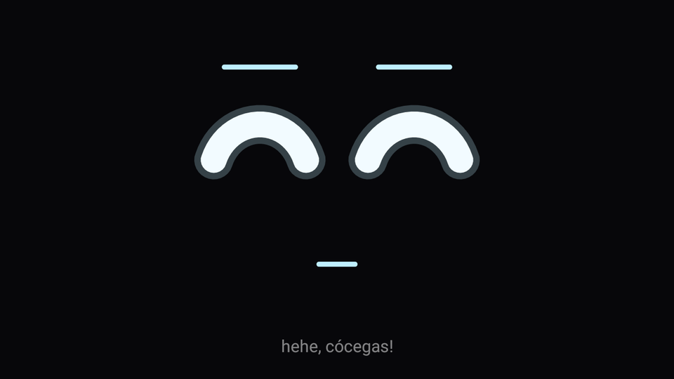
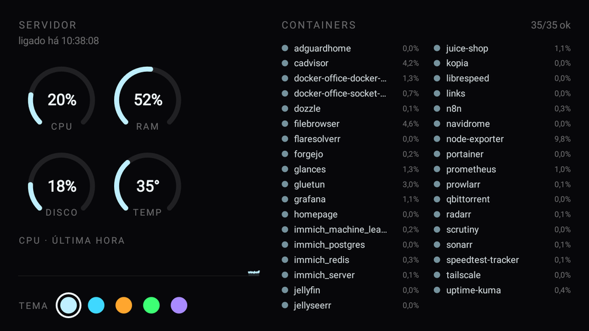
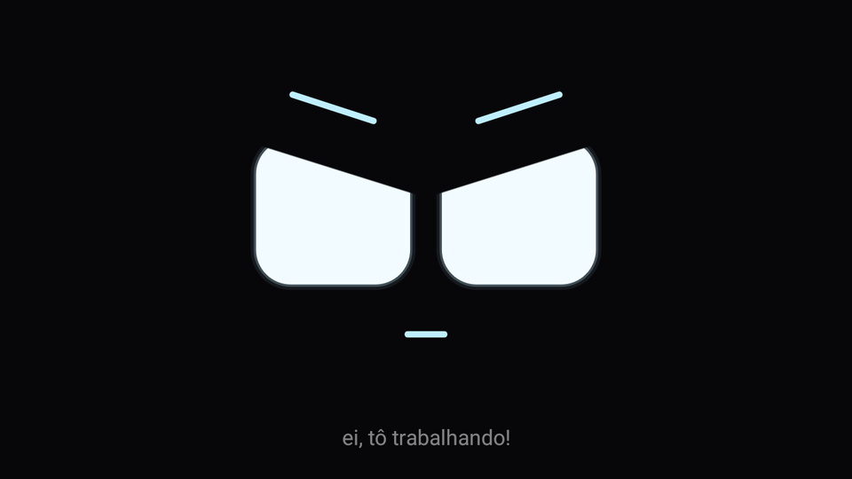
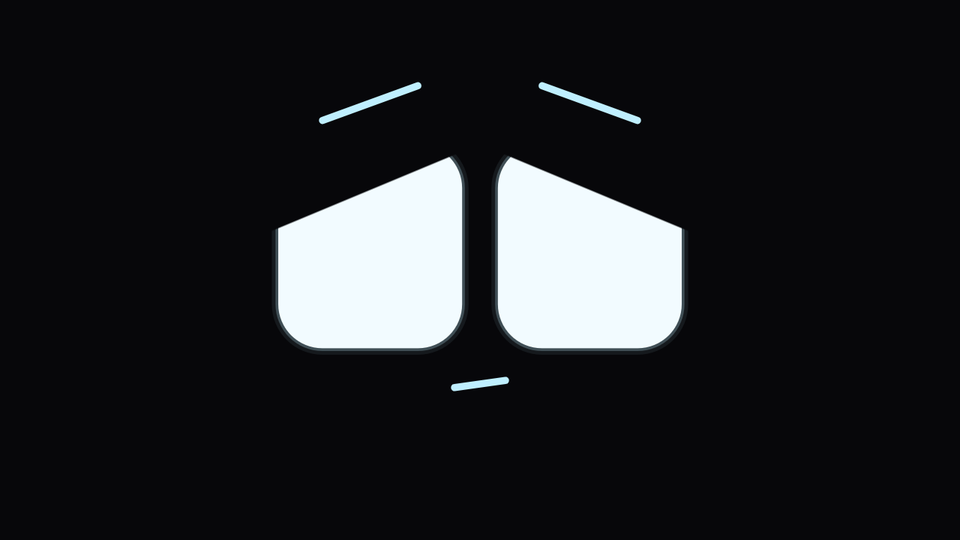

# Dockmon

Um bichinho virtual que mora num Moto C Plus antigo e vigia o servidor de casa.

<p align="center"></p>

> **Feito por IA.** Todo o código, os testes, os scripts e esta documentação foram escritos pelo Claude (Anthropic), via Claude Code, a partir das ideias e dos testes no aparelho do autor do projeto.

**Clanker**, o segurança dedicado demais: um robozinho que leva o trabalho de vigiar o servidor como se fosse a missão da vida dele. Fala de cada container como se fosse um filho, entra em pânico com qualquer queda e comemora uma volta como final de campeonato. Nunca tirou férias e não pretende tirar. No fundo, tem medo de que, se piscar por muito tempo, alguma coisa caia.

O celular vira um display dedicado: liga direto no Clanker, sem launcher, barra de status ou tela de bloqueio.

## As três telas

Arrastando para os lados:

| ← Painel | Clanker (início) | Música → |
|---|---|---|
| CPU, RAM, disco e temperatura, gráfico da CPU na última hora, tempo ligado, lista dos containers com os problemáticos primeiro, escolha de tema | o rosto, que reage ao servidor e à hora do dia | o que toca no Spotify: capa, ⏮ ⏯ ⏭ e barras estilo cava |

Depois de 60 s sem toque, qualquer tela volta para o Clanker.

<p align="center"></p>

## Humor

**O que acontece no servidor:**

| Situação | Reação |
|---|---|
| Container caiu | susto (olhos vermelhos com glitch), depois preocupado |
| Container voltou | comemora |
| Container novo | fogos de artifício |
| CPU alta ou temperatura alta | bravo |
| Disco cheio ou temperatura crítica | dramático |
| Servidor sem resposta | fica procurando |
| Tudo bem | manias aleatórias, olhos de coração de vez em quando |

Ele fala quando acontece algo com um container ou com o hardware, quando você toca nele ou quando fica com ciúme ("PERDI O nginx!", "CPU em 93%, aguenta firme!"). No resto do tempo, só faz caras.

**Quando você toca nele** (ele olha para onde o dedo tocou):

| Toques seguidos | Reação |
|---|---|
| 1 | "oi! que bom te ver!" e um pulinho (à noite: "hm? já é de noite...", com sono) |
| 2 | "hehe, cócegas!", com cócegas |
| 3–4 | "ei, para de me cutucar!", bravo |
| 5 ou mais | "socorro, alguém me salva!", dramático |

<p align="center">
  
  
</p>

**Ciúme da música:** se você passa mais de 30 s na tela de música, ele volta emburrado, olhando para o outro lado: "hmpf... trocou o segurança pela música". Depois de 3 min, fica dramático: "achei que tinha sido demitido!". Um toque nele desfaz o bico.

**A bateria do celular:** um ícone aparece no canto superior direito, em qualquer tela, quando a bateria está em 20% ou menos fora da tomada (âmbar; pisca em vermelho a partir de 10%) ou quando a bateria passa de 45 °C (pisca em vermelho e mostra a temperatura). Ele também avisa: "bateria em 15%, preciso de tomada!", "bateria em 7%, vou apagar no turno!", "tô a 46 °C, superaquecendo!". Quando esquenta, o brilho cai para 5% até esfriar. No painel do servidor, um ícone de bateria ao lado de "SERVIDOR" abre com um toque e mostra carga, temperatura e se está na tomada.

**A hora do dia:**
- **Manhã (6h–12h):** agitado, mexe toda hora e dá pulinhos.
- **Tarde (12h–18h):** vai cansando, com sono cada vez mais frequente.
- **Noite (18h–6h):** calmo, olhos tranquilos e poucas manias.

## Como funciona

- **Servidor:** o app lê a API do [Glances](https://github.com/nicolargo/glances) (`/api/4`) a cada 5 s. Nada precisa ser instalado no servidor além do Glances.
- **Música:** a API Web do Spotify com login PKCE, feito uma vez pelo PC. A música toca no PC e o celular só mostra e controla. As barras são simuladas a partir do andamento de cada faixa, porque o Spotify não fornece a análise de áudio para apps novos.
- **Modo dedicado:** o app é *Device Owner*. Usa lock task, desativa a barra de status e o bloqueio de tela e se define como HOME. 82 apps de fábrica foram desativados (lista em `device/apps-desativados.txt`).
- **Leve de propósito:** Kotlin puro com Canvas, sem Compose, coroutines ou bibliotecas de rede. Ocupa cerca de 15 MB de RAM e desenha a uns 13 fps quando está parado.

```
app/src/main/java/dev/rique/guardiao/
├── face/      rosto (Canvas), formatos dos olhos, fogos
├── mood/      motor de humor e ciclo do dia
├── server/    cliente e parser do Glances, detector de eventos
├── panel/     painel do servidor
├── music/     Spotify (PKCE, API, poller), tela e ritmo das barras
├── ui/        paginação por arraste e temas
├── settings/  preferências e tela de configuração escondida
└── kiosk/     modo dedicado (Device Owner)
```

## Hardware

Moto C Plus (XT1726), Android 7.0, MT6737M, cerca de 900 MB de RAM, tela 720×1280. O bootloader segue bloqueado, então o logo da Motorola ainda aparece no boot. Qualquer Android 7+ deve servir.

**Suporte impresso em 3D:** o celular fica num suporte com inclinação ajustável, duas ventoinhas atrás e uma moldura que deixa só a tela aparecendo. Ele foi feito sob medida para o Moto C Plus. STLs, peças e montagem em [`suporte/`](suporte/README.md).

## Montando o seu

Requisitos: JDK 21, Android SDK (API 35) e um servidor com Glances acessível na rede.

1. **Compilar:**
   ```sh
   ./gradlew :app:testDebugUnitTest :app:assembleDebug
   ```
2. **Preparar o celular:** ative a depuração USB e remova todas as contas do aparelho. O Android só aceita definir um *Device Owner* sem contas.
3. **Instalar e tornar o app dono do aparelho:**
   ```sh
   ./device/provisionar.sh adb
   ```
4. **Configurar:** segure o canto superior esquerdo da tela por 5 s para abrir as configurações. Ali ficam a URL do Glances, os limites de alerta e o brilho.
5. **Spotify (opcional):**
   1. Crie um app em <https://developer.spotify.com/dashboard> com o redirect `http://127.0.0.1:8888/callback`.
   2. Coloque o Client ID nas configurações.
   3. Rode:
      ```sh
      python3 device/spotify-login.py adb
      ```

## Desligando

Segure o botão de ligar e toque em **Desligar**. Ao ligar de novo, ele volta direto para o Clanker. Com o cabo no PC também dá: `adb shell reboot -p`.

## Voltando ao normal

```sh
./device/remover-dono.sh adb     # sai do modo dedicado
./device/restaurar-apps.sh adb   # reativa os apps de fábrica
```

Também dá para sair pelo botão "Sair do modo kiosk" nas configurações.

Guia do dia a dia: [docs/USO.md](docs/USO.md).

## Licença

MIT
