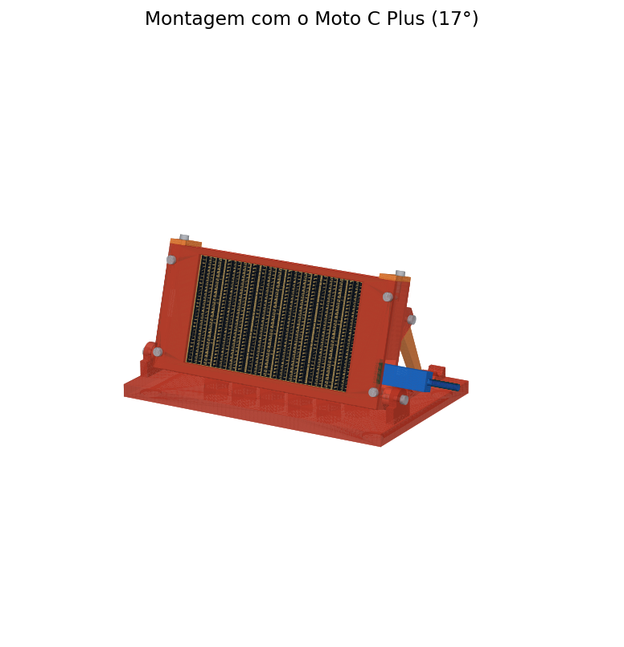
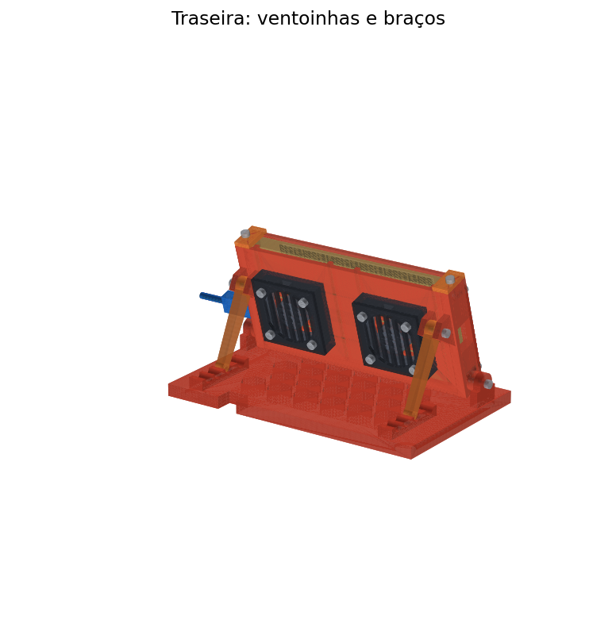
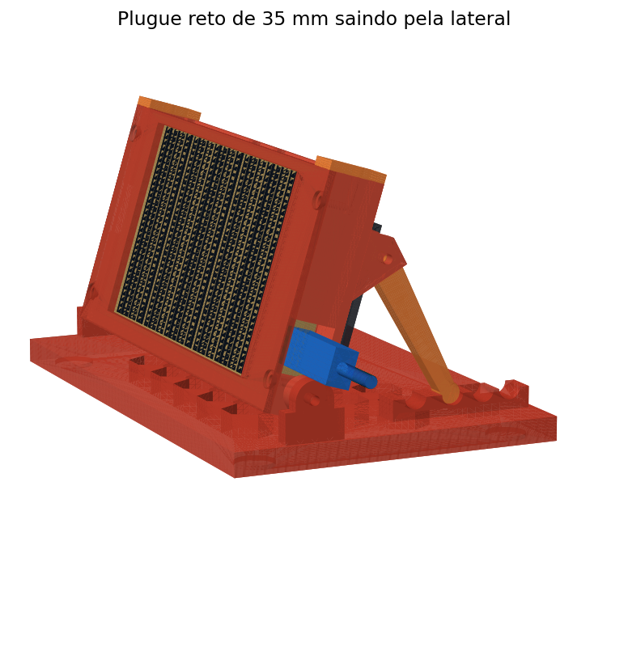

# Suporte refrigerado para Motorola Moto C Plus

> **Feito sob medida para o Motorola Moto C Plus (XT1726), sem capa.** Medidas do aparelho: 144 × 72,3 × 10 mm. Em outro celular, o encaixe, a janela da tela e a fresta do carregador não vão bater.

Suporte de mesa para deixar o Moto C Plus ligado o tempo todo como display do [Dockmon](../README.md): o celular fica deitado, inclinado, com duas ventoinhas de 40 mm soprando nas costas e uma moldura que cobre as bordas para só a tela aparecer.

  
  

- 4 inclinações: 10°, 17°, 24° e 31°
- Cabe numa mesa de impressão de 220 × 220 mm; montado, ocupa cerca de 18 × 11 × 9,5 cm
- Nenhuma peça precisa de suporte de impressão
- Cotas de todas as peças em [`desenho-tecnico.pdf`](desenho-tecnico.pdf)

## Peças para imprimir

As STLs em [`stl/`](stl) já estão na posição de impressão.

| STL | Qtd | Posição na mesa | Observação |
|---|---|---|---|
| `01_base.stl` | 1 | deitada | 181 × 112 mm |
| `02_berco.stl` | 1 | em pé (como está) | use brim de 5 mm |
| `04_moldura.stl` | 1 | deitada, face da frente na mesa | fica bonita em preto fosco |
| `05_trava_x2.stl` | 2 | deitada | |
| `07_alojamento_ventoinha_x2.stl` | 2 | em pé | |
| `09_grade_x2.stl` | 2 | deitada | |
| `11_braco_x2.stl` | 2 | deitada | 5 paredes ou 100% de preenchimento |

**Material:** PETG. O celular fica carregando o tempo todo e as costas chegam a uns 40–45 °C; o PLA amolece perto de 55–60 °C e pode deformar com o tempo. PLA serve se ficar longe do sol.

**Configuração:** bico 230–245 °C, mesa 70–80 °C, camada 0,2 mm, 4 paredes, 25% de preenchimento gyroid. Gasta cerca de 150 g.

## Compras

| Item | Qtd |
|---|---|
| Ventoinha 40×40×10 mm **5 V** | 2 |
| Cabo USB para as ventoinhas (ou ventoinhas que já vêm com USB) | 1 |
| Carregador 5 V com 2 saídas USB (2 A ou mais no total) | 1 |
| Parafuso M3×8 (moldura) | 4 |
| Parafuso M3×10 (travas) | 2 |
| Parafuso M3×12 (eixo) | 2 |
| Parafuso M3×16 (braços) | 2 |
| Parafuso M3×16 (ventoinhas) | 8 |
| Arruela M3 (eixo) | 2 |
| Pé de borracha adesivo Ø12–13 mm | 4 |

Os furos de rosca têm Ø2,5 mm: o parafuso M3 abre a própria rosca no plástico.

## Montagem

1. **Ventoinhas:** encaixe cada ventoinha no alojamento com o **lado do adesivo virado para o celular**, para soprar nas costas dele. Feche com a grade e prenda grade, ventoinha e painel com 4 M3×16. Passe os fios pelo rasgo de cima do alojamento.
2. **Pés de borracha:** cole nos 4 rebaixos embaixo da base.
3. **Articulação:** encaixe o berço entre as orelhas da base e prenda com M3×12 e arruela, de fora para dentro, um de cada lado. Aperte até ficar firme, mas ainda girando.
4. **Braços:** prenda cada braço no garfo da ponta de trás com M3×16, de fora para dentro. Apoie os dois pés no mesmo entalhe das duas cremalheiras.
5. **Moldura:** parafuse a moldura na frente do berço com 4 M3×8.
6. **Celular:** sem as travas, deslize o celular de cima para baixo, entre o painel e a moldura, com a **entrada USB virada para a direita**. Os botões de volume e ligar ficam no lado de cima, livres. Coloque as duas travas no topo com M3×10.
7. **Carregador:** o plugue entra pela fresta da lateral direita. Cabo reto com ponta de até 35 × 12 × 8 mm passa em todas as inclinações. Junte os cabos do celular e das ventoinhas e passe pelo recorte de trás da base.

## Inclinação

Levante o celular, tire os pés dos braços e apoie no entalhe desejado (o mesmo nos dois lados).

| Entalhe (de frente para trás) | Inclinação |
|---|---|
| 1º | 10° |
| 2º | 17° |
| 3º | 24° |
| 4º | 31° |

## Medidas usadas

| O quê | Valor |
|---|---|
| Celular | 144 × 72,3 × 10 mm, folga de 1,2 mm na largura e na altura e 1 mm na espessura |
| Janela da moldura | 115 × 67,3 mm, centralizada (bordas de 15 mm nas laterais e 3 mm em cima e embaixo, medidas no aparelho, mais 0,5 mm de folga por lado) |
| Fresta do carregador | 18 × 14 mm na lateral direita, centrada a 17 mm da borda de baixo do celular |

As bordas e a posição da entrada foram medidas à mão num aparelho. Vale imprimir primeiro só a moldura (cerca de 30 min) e encostar no celular para conferir.
